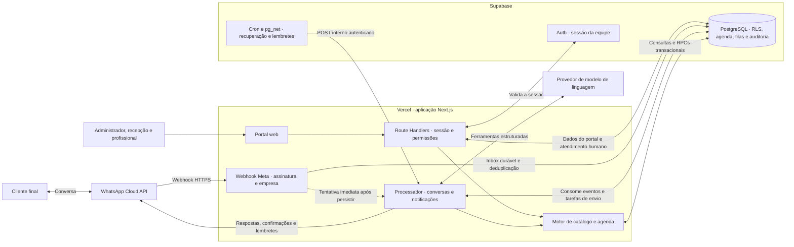

# Agenda SaaS — especificação de implementação

## Instruções para o agente de desenvolvimento

Implemente o MVP descrito neste documento no repositório `agenda-saas`. Se o repositório estiver vazio, inicialize um projeto Next.js com TypeScript. Se já existir código, inspecione-o e preserve as convenções compatíveis com esta especificação. Entregue cada fase com código funcional, migrations aplicáveis, testes dos fluxos críticos e instruções reproduzíveis no README. Use dados fictícios e adaptadores de teste para permitir desenvolvimento sem credenciais da Meta ou do provedor de IA.

## Objetivo e escopo

Criar um SaaS de agendamento multiempresa para barbearias, salões, estúdios e clínicas. O cliente conversa em português no WhatsApp para descobrir serviços, preços, profissionais e horários, além de agendar, remarcar e cancelar. Administradores, recepcionistas e profissionais operam a mesma agenda pelo portal web.

O MVP atende uma unidade e um número comercial por empresa, vários profissionais por unidade, um profissional por reserva e um serviço por reserva. Cada empresa configura moeda, fuso IANA, intervalo entre horários oferecidos e política de cancelamento. O seed usa BRL e `America/Sao_Paulo`. Em clínicas, o atendimento automatizado cobre apenas informações administrativas e agendamento. Encaminhe perguntas clínicas à equipe.

### Stack

- **Vercel** hospeda um único projeto Next.js com App Router, portal e Route Handlers Node.js. O processamento de mensagens é executado em funções curtas, com estado persistente no banco.
- **Supabase** fornece PostgreSQL, Auth com sessão SSR e RLS. Use migrations SQL versionadas, Supabase CLI no ambiente local e tipos gerados do banco.
- **Supabase Cron e pg_net** acionam uma rota interna da Vercel para recuperar tarefas pendentes, reprocessar falhas e enviar lembretes. Configure a URL e o segredo usando Supabase Vault. Use o banco como fila durável.
- **WhatsApp Cloud API oficial da Meta** recebe e envia mensagens. A integração com o modelo de linguagem usa um adaptador com chamadas de ferramentas estruturadas. O banco e o motor de agenda são a fonte de serviços, preços e horários.
- **Interface** responsiva em português do Brasil. Use componentes acessíveis, validação de entrada no servidor e estados explícitos de carregamento, erro, vazio e conflito.

## Arquitetura



### Estrutura do repositório

```text
agenda-saas/
├── src/
│   ├── app/                     # Páginas e Route Handlers
│   ├── components/              # Interface compartilhada
│   └── modules/
│       ├── auth/                 # Sessão e escopo da empresa
│       ├── catalog/              # Serviços, preços e profissionais
│       ├── scheduling/           # Disponibilidade e operações da agenda
│       ├── conversations/        # Estado, ferramentas e transferência humana
│       ├── notifications/        # Fila de saída, lembretes e status
│       └── integrations/         # Adaptadores WhatsApp, IA e Supabase
├── supabase/
│   ├── migrations/              # DDL, RLS, RPCs e índices
│   └── seed.sql                 # Empresas de exemplo e dados fictícios
├── tests/                        # Regras, integração e fluxos ponta a ponta
├── .env.example
├── README.md
└── spec.md
```

## Portal e permissões

| Área | Comportamento esperado |
|---|---|
| Acesso | Login por e-mail com Supabase Auth. Usuários com múltiplos vínculos escolhem uma empresa ativa. |
| Serviços | Gerenciar descrição, duração, preço e profissionais habilitados. Arquivar serviços sem apagar o histórico. |
| Equipe | Gerenciar profissionais e vínculos de acesso. Um profissional pode existir na agenda antes de ter login. |
| Expediente | Configurar turnos recorrentes, intervalos, folgas e bloqueios por profissional. Mostrar reservas afetadas por mudanças e oferecer remarcação ou cancelamento explícitos. |
| Agenda | Calendário diário e semanal com filtro por profissional. Criar, remarcar e cancelar reservas. Mostrar histórico e origem da reserva. |
| Atendimento | Listar conversas transferidas. A equipe assume, responde pelo mesmo canal e pode devolver a conversa ao agente. |
| Configurações | Cadastrar fuso, moeda, regras de agendamento e cancelamento. Mostrar o estado da integração com o WhatsApp. No piloto, provisionar o número e as credenciais pelo servidor. |

**Administrador** gerencia catálogo, configurações, equipe e agendas da empresa. **Recepção** opera todas as agendas e assume conversas. **Profissional** vê e opera a própria agenda e os próprios bloqueios. Valide papéis e escopo no servidor e no banco. Proteja todas as telas privadas.

## Modelo de dados

Use UUIDs, timestamps de auditoria e `tenant_id` nos registros que pertencem a uma empresa. Em relações entre entidades da empresa, use chaves estrangeiras compostas com `tenant_id` para impedir referências cruzadas.

| Tabela | Dados essenciais |
|---|---|
| `tenants`, `memberships` | Empresa, fuso, moeda e políticas. Vínculo entre usuário do Auth, empresa, papel e profissional opcional. |
| `professionals`, `services`, `professional_services` | Equipe, catálogo e profissionais habilitados para cada serviço. Duração em minutos e preço em unidades monetárias mínimas, como centavos. |
| `weekly_availability`, `schedule_exceptions` | Turnos e pausas em hora local. Bloqueios e exceções pontuais por profissional. |
| `customers` | Nome opcional e contato normalizado. Identidade única por empresa e contato. |
| `appointments` | Cliente, profissional, serviço, início, fim, status e origem. Preserve nome do serviço, duração, preço e moeda acordados no momento da reserva. |
| `whatsapp_connections` | Empresa, identificadores da conta e `phone_number_id` único. Guarde uma referência à credencial protegida. |
| `conversations` | Empresa, cliente, canal, modo humano ou automático e contexto mínimo necessário. |
| `inbound_events`, `outbound_jobs` | Eventos recebidos e comandos de envio. Chaves de deduplicação, estado, tentativas, horário da próxima execução e prazo de recuperação. |
| `audit_events` | Autor, empresa, entidade, operação e mudanças relevantes. |

### Regras da agenda e segurança das operações

1. Calcule opções dentro do expediente local. Desconte intervalos, folgas, bloqueios e reservas ativas. Aplique duração do serviço, passo de oferta, antecedência mínima e limite de busca. Grave os instantes das reservas como `timestamptz` e exiba no fuso da empresa.
2. Centralize criação, remarcação e cancelamento em funções transacionais do banco chamadas pelos dois canais. Valide vínculo do profissional, serviço, empresa, cliente e regras aplicáveis. Recalcule disponibilidade e preço antes de confirmar. Se o preço ou as condições exibidas mudarem, solicite nova confirmação.
3. Use `tstzrange` com limites `[)` e uma restrição de exclusão GiST, via `btree_gist`, por empresa, profissional e faixa de horário nas reservas ativas. Para mudanças concorrentes de expediente e reserva, serialize as gravações por profissional com um lock transacional compartilhado entre essas operações. Ao trocar de profissional, adquira os locks em ordem consistente. Retorne conflito acionável e mantenha a reserva anterior se a remarcação falhar.
4. Exija chave de idempotência para mutações. Uma repetição da mesma operação deve devolver o resultado registrado. Uma chave reutilizada com dados diferentes deve retornar conflito. Grave mutação, auditoria e evento de notificação na mesma transação.
5. Ative RLS nas tabelas expostas. Use a sessão do usuário nas requisições do portal. Reserve credenciais privilegiadas para integrações e validações específicas no servidor, em módulos exclusivos de servidor. Restrinja as permissões das RPCs e valide explicitamente empresa e papel em toda função privilegiada. A empresa da sessão vem do vínculo validado. A empresa de uma mensagem vem do número comercial verificado.
6. Limite o acesso à conversa e ao histórico conforme os papéis. Guarde apenas o necessário para atender e agendar. Evite telefones completos, tokens e conteúdo de conversa em logs de aplicação. Documente retenção e expurgo de mensagens para o piloto.

## WhatsApp e agente

### Entrada e processamento

- Exponha `GET /api/webhooks/whatsapp` para o desafio de verificação da Meta e `POST /api/webhooks/whatsapp` para os eventos. Verifique `X-Hub-Signature-256` com o corpo bruto e o segredo do app antes de interpretar o JSON.
- Separe mensagens recebidas de eventos de status. Resolva a empresa pelo `phone_number_id`. Persista os eventos reconhecidos, deduplique pela identidade do evento e responda à Meta após a gravação. Se o banco falhar, retorne erro temporário para permitir nova entrega.
- Faça uma tentativa rápida de processamento com `after()` após o aceite do webhook. Sirva também `POST /api/internal/jobs/process` com autenticação por segredo para a execução periódica via Supabase Cron. A fila persistente é a base da recuperação. Nunca dependa do callback de execução imediata para preservar trabalho.
- Reserve lotes pequenos de jobs com bloqueio concorrente e prazo de execução recuperável. Processe uma mensagem de cada vez por conversa. Use tentativas limitadas, retentativa com atraso e estado terminal visível para operação. Trate alterações de status de entrega de forma idempotente. Registre identificadores de envio retornados pela Meta. Em caso de resposta ambígua após a chamada externa, registre o envio como incerto para evitar reenvio automático cego.

### Ferramentas permitidas ao agente

| Ferramenta | O que consulta ou executa |
|---|---|
| `list_services` | Serviços ativos, descrição, duração e preços cadastrados. |
| `list_professionals` | Profissionais ativos e habilitados para o serviço. |
| `list_available_slots` | Horários efetivamente disponíveis no fuso da empresa. |
| `list_my_appointments` | Reservas associadas ao contato e à empresa da conversa. |
| `create_appointment` | Cria a reserva da proposta confirmada pelo cliente. |
| `reschedule_appointment` | Troca o horário da reserva do próprio cliente após confirmação. |
| `cancel_appointment` | Cancela a reserva do próprio cliente conforme a política configurada. |
| `request_handoff` | Marca a conversa para a equipe e suspende respostas automáticas enquanto houver atendimento humano. |

Injete empresa e contato pelo servidor e valide argumentos com esquema tipado. Vincule cada opção oferecida a uma proposta com prazo e identificador opaco. Antes de qualquer alteração, recapitule os dados relevantes e exija confirmação explícita. Se a resposta for ambígua ou a proposta vencer, ofereça novas opções. Informe que a operação foi concluída somente após receber o resultado do motor. Em conflito, apresente alternativas. Transfira para a equipe quando solicitado, quando faltar informação ou quando o assunto estiver fora do catálogo administrativo.

### Envio e lembretes

Gere confirmações de criação, remarcação e cancelamento quando houver um canal WhatsApp válido para aquele cliente. Programe um lembrete por reserva com antecedência configurável, usando uma chave única por reserva, versão e tipo. Ao remarcar ou cancelar, invalide tarefas anteriores e revalide estado e versão antes de enviar. Use modelos aprovados pela Meta para mensagens fora da janela de 24 horas desde a última mensagem do cliente. Registre autorização de contato quando exigida e respeite solicitações de interrupção de mensagens. Ofereça caminho direto para atendimento humano.

## Ordem de implementação

| Fase | Entrega verificável |
|---|---|
| 1 · Fundação | Next.js local, Supabase Auth SSR, migrations e seeds para dois negócios, isolamento RLS e portal protegido. |
| 2 · Agenda | Serviços, profissionais, horários, calendário e fluxos manuais. Bloqueios, conflitos e alterações concorrentes cobertos por teste. |
| 3 · WhatsApp | Webhook validado, adaptador Meta e modo simulado. Cliente consulta, cria, remarca e cancela pela conversa. Mudanças aparecem no portal. |
| 4 · Piloto | Atendimento humano, lembretes, recuperação de jobs, logs correlacionados e deploy em ambiente de piloto. Validação real com número de teste ou autorizado da Meta. |

## Critérios de aceite

- O seed demonstra dois segmentos com configurações distintas usando o mesmo fluxo. Uma pessoa da empresa A tem acesso somente aos dados e operações autorizados da empresa A, inclusive ao tentar consultar IDs diretamente na API ou nas RPCs.
- A recepção cadastra serviço, preço, profissional, expediente e pausa, cria uma reserva, remarca e cancela pelo portal. Um profissional consegue operar a própria agenda dentro das suas permissões.
- O agente usa dados cadastrados, oferece horários válidos, pede confirmação e cria a reserva. A equipe consegue assumir a conversa no portal e responder sem interferência do agente.
- Duas confirmações simultâneas para o mesmo horário de um profissional resultam em uma única reserva. Horários adjacentes são aceitos. Horários em pausa ou bloqueados são recusados. Falha ao remarcar preserva a reserva antiga.
- Reentrega de webhook ou repetição da mesma confirmação não gera segunda reserva. Um job interrompido é retomado após o prazo de recuperação. Lembretes de versões antigas são descartados.
- Um teste ponta a ponta percorre o portal e o canal simulado sem credenciais externas. O README identifica quais verificações exigem número Meta ativo e credenciais reais.

## Configuração e entregáveis

- Entregue código, `.env.example` sem valores secretos, migrations, seeds, testes e README com instalação local, publicação na Vercel, configuração do Supabase e procedimento de validação do webhook da Meta.
- No navegador, exponha somente a URL do projeto e a chave publicável do Supabase. Configure no servidor a chave privilegiada do Supabase, os segredos da Meta, as credenciais de envio, a chave do modelo e o segredo de invocação dos jobs. Mantenha ambientes de desenvolvimento, piloto e produção separados.
- Documente como configurar o job recorrente no Supabase com `pg_net`, como inspecionar falhas e como reprocessar uma tarefa. Valide o job remoto com uma tarefa fictícia antes de ativar lembretes para clientes.
- Mantenha cobrança, unidades adicionais, recursos compartilhados, turmas, integração com calendários externos e Embedded Signup para fases futuras. O piloto usa conexão assistida do número da empresa.

## Referências oficiais

- [Supabase Auth no Next.js](https://supabase.com/docs/guides/auth/server-side/nextjs) e [Row Level Security](https://supabase.com/docs/guides/database/postgres/row-level-security)
- [Supabase Cron](https://supabase.com/docs/guides/cron) e [pg_net](https://supabase.com/docs/guides/database/extensions/pg_net)
- [Processamento orientado a eventos na Vercel](https://vercel.com/i/event-driven-architecture)
- [Restrições de exclusão para intervalos no PostgreSQL](https://www.postgresql.org/docs/current/rangetypes.html#RANGETYPES-CONSTRAINT)
- [WhatsApp Business Platform](https://developers.facebook.com/documentation/business-messaging/whatsapp/overview/) e [Política de Mensagens do WhatsApp Business](https://business.whatsapp.com/policy/preview?lang=pt_BR)
